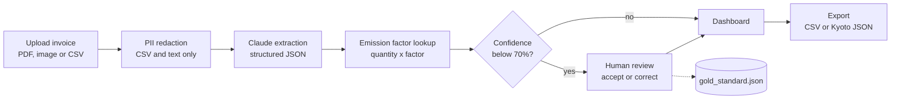

# SupplierTrace AI

**Turn supplier invoices into Scope 3 emissions estimates, with a human check on anything the AI isn't sure about.**

SupplierTrace AI is a Streamlit prototype that reads supplier documents (PDF invoices, scans, CSV exports), uses Claude to pull out the line items, maps each one to a material and a GHG Protocol Scope 3 category, and calculates the emissions. Lines the model is unsure about land in a review queue, and nothing can be exported until a person has dealt with them.

> **Status:** prototype (v0.2). Estimates use static emission factors and this is not an audited carbon inventory. See [Known limitations](#known-limitations).

## Why this exists

For many companies, Scope 3 emissions from purchased goods and freight are the largest part of their footprint, and the data sits in supplier paperwork: invoices in different layouts, formats and units. Collecting it is mostly manual work. This project explores how much of that extraction an LLM can take over while keeping a person accountable for the numbers that leave the system.

## Features

- **Document intake:** upload a PDF, PNG, JPG or CSV supplier document.
- **Structured extraction with Claude:** supplier, invoice number, date, currency and total value, plus per-line description, quantity, unit, material, Scope 3 category, a 0 to 1 confidence score and a short data-quality flag (for example "quantity estimated").
- **Emission calculation:** quantity multiplied by an emission factor from a built-in table of 38 entries (sources labelled as DEFRA 2023, EPA 2022 and CEA India 2023), reported in tCO₂e.
- **Human-in-the-loop review:** any line below 70% confidence is flagged. Export stays locked until each flagged line is accepted or corrected. Corrections are logged to `gold_standard.json`.
- **PII redaction before the API call:** regex-based scrubbing of bank details, Indian tax and company IDs, cards, emails, phone numbers and similar. Applies to CSV/text input only (see limitations).
- **Dashboard:** total emissions, average confidence, items needing review, carbon intensity (kgCO₂e per currency unit of spend), a breakdown by Scope 3 category, a confidence distribution and a breakdown by material.
- **Supplier session history:** running totals per supplier and invoice for the current session.
- **Exports:** CSV, a Kyoto™-style JSON payload (`kyoto_v1`), and a mocked "Sync to Kyoto™" button.

## How it works



1. The document is checked for PII (text formats only) and sent to Claude with a system prompt that asks for a fixed JSON schema.
2. Claude must choose each line's `material_key` from the keys in `emission_factors.py`, so every extracted line maps to a known factor.
3. The app multiplies quantity by the factor and groups results by Scope 3 category and material.
4. Lines below the confidence threshold (`CONF_THRESHOLD = 0.70`) are marked for review. A reviewer can change the material or quantity and save the correction, or accept the AI output as it is.
5. Once no flagged lines are pending, the CSV and Kyoto JSON downloads and the sync button unlock.

## Quick start

You need Python 3.10 or newer. An Anthropic API key is only needed for your own documents, the demo works without one.

```bash
git clone https://github.com/Manav1119/SupplierTrace-AI.git
cd SupplierTrace-AI

python -m venv .venv
source .venv/bin/activate        # Windows: .venv\Scripts\activate

pip install -r requirements.txt
streamlit run app.py
```

Then open the local URL Streamlit prints (usually http://localhost:8501).

### Using the app

1. Click **Load demo invoice** to explore with a sample metals-supplier invoice (steel, aluminium, copper, HDPE film and road freight, about 6.74 tCO₂e in total). No API key needed.
2. To use your own document, paste your Anthropic API key into the sidebar, upload a file and click **Analyse document**. The key is used for the request and is not written to disk by the app.
3. Review the summary cards and charts.
4. Work through any flagged line items: edit the material or quantity and click **Save correction**, or click **Accept AI output as-is**.
5. Download the CSV or Kyoto™ JSON, or click **Sync to Kyoto™** (mocked).

The demo invoice is all high-confidence, so the review queue only appears when you analyse a document with ambiguous line items.

## Project structure

| File | What it does |
| --- | --- |
| `app.py` | Streamlit UI: upload, results dashboard, review queue, session history, exports and the mocked Kyoto™ sync. |
| `extractor.py` | Builds the prompt, calls the Claude API (PDF, image and text inputs), parses the JSON response, and holds the demo invoice data. |
| `pii_redactor.py` | Regex-based PII redaction with a per-run audit log. Run `python pii_redactor.py` for a quick smoke test. |
| `emission_factors.py` | Emission factor table, Scope 3 category labels and the CO₂e calculation helpers. |
| `requirements.txt` | Dependencies: `streamlit`, `anthropic`, `pandas`, `plotly`. |

## Customising

- **Model:** the model name and `max_tokens` are set in `extract_from_document()` in `extractor.py` (currently `claude-opus-4-5`).
- **Review threshold:** change `CONF_THRESHOLD` at the top of `app.py`.
- **Add a material or factor:** add an entry to `EMISSION_FACTORS` in `emission_factors.py`. It is automatically offered to Claude and appears in the review dropdown.

  ```python
  "your_material_key": {"factor": 0.0,  # replace with a sourced value
                        "unit": "kg", "label": "Your material", "source": "Your source"},
  ```
- **Real Kyoto™ sync:** the sync button in `app.py` only shows a spinner and a success message. Replace it with an authenticated POST to your ingestion endpoint.

## Outputs

- **CSV:** one row per line item with description, quantity, unit, material, Scope 3 category, emission factor and source, tCO₂e, confidence, a `Human verified` flag, and the supplier and invoice details.
- **Kyoto™ JSON:** schema `kyoto_v1` with the invoice header, region, total tCO₂e, carbon intensity, number of PII redactions and every line item with its factor and verification status.
- **`gold_standard.json`:** each time you click **Save correction**, the original and corrected material and quantity are appended here (with timestamp and the original confidence). The file is written to the working directory and can also be downloaded from the sidebar. The idea is to build a labelled dataset for evaluating, or later training, a cheaper extraction model. Lines accepted as-is are not logged.

## Known limitations

This is a prototype, and these are the gaps to know about before relying on the numbers:

- **PII redaction only covers CSV and text files.** PDFs and images are sent to the API as they are, because scrubbing binary files would need a separate PDF/OCR pipeline. For sensitive documents, redact them first or use a deployment you control.
- **Redaction is pattern-based.** It can over-redact (for example, any all-caps word of 8 or 11 characters matches the SWIFT/BIC pattern, which can hit CSV column headers) and can mislabel what it caught.
- **No unit conversion.** The app multiplies the extracted quantity by the factor as is, so a quantity given in tonnes or grams against a per-kg factor will be off. The review step is the safeguard.
- **Static, hard-coded emission factors.** There is one factor per material and the values are not validated or updated by the app. Check them against the published source before using results for reporting.
- **The region selector does not change calculations.** The sidebar "Region / EF priority" choice is recorded in the export payload only.
- **Kyoto™ sync is a mock.** Nothing is sent anywhere.
- **Model output can be wrong.** Quantities may be estimated by the model (flagged when so), and a malformed JSON response shows an error and needs a retry.
- **Session-only state.** Supplier history lives in the browser session, and there is no database or automated test suite yet.

## Tech stack

Python, Streamlit, the Anthropic Claude API (PDF and image inputs), pandas and Plotly.

## Author

Built by [Manav Bhardwaj](https://www.linkedin.com/in/manav-bhardwaj) ([@Manav1119](https://github.com/Manav1119)).
